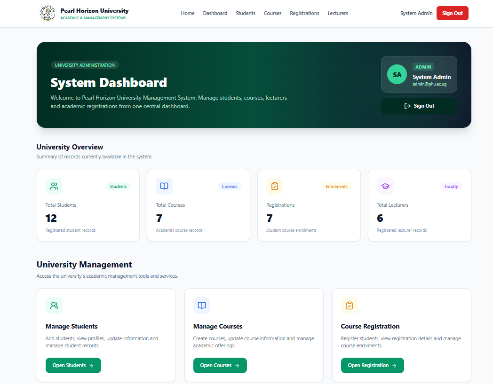
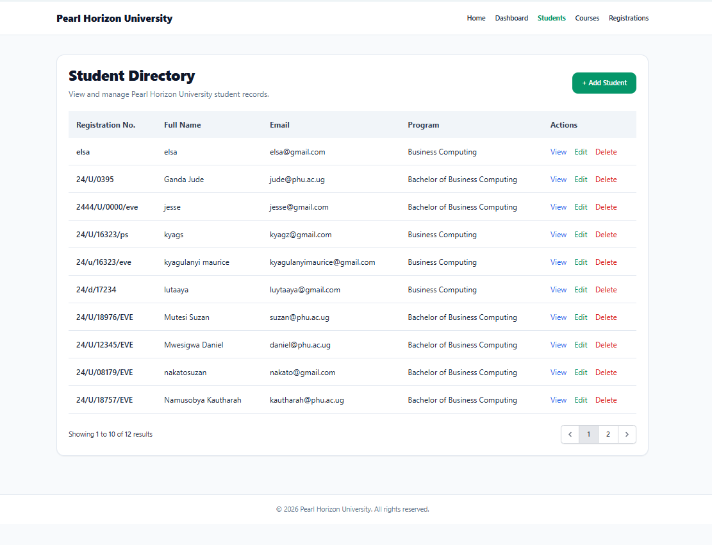
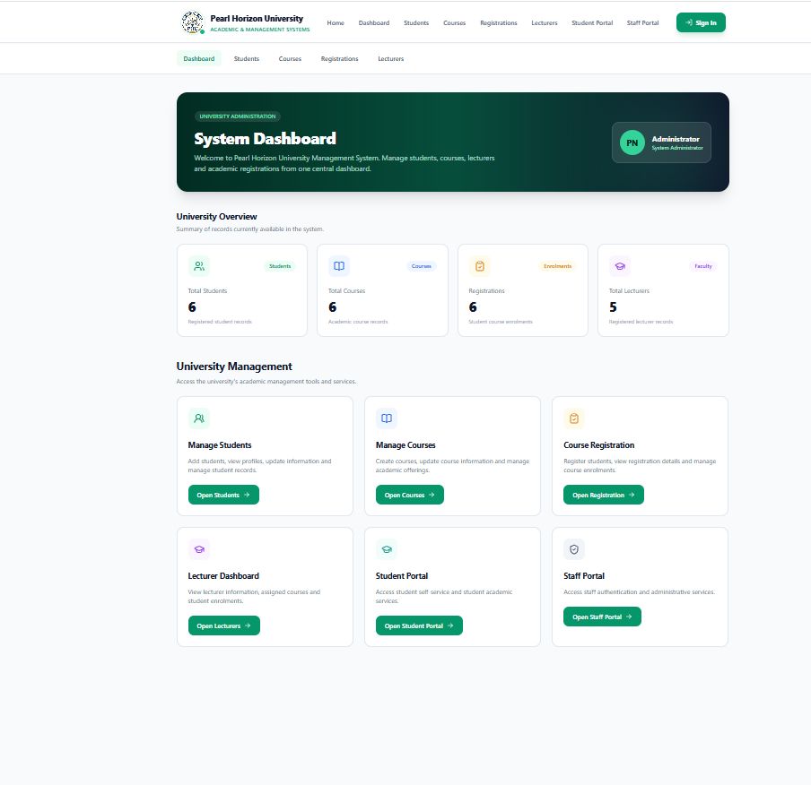
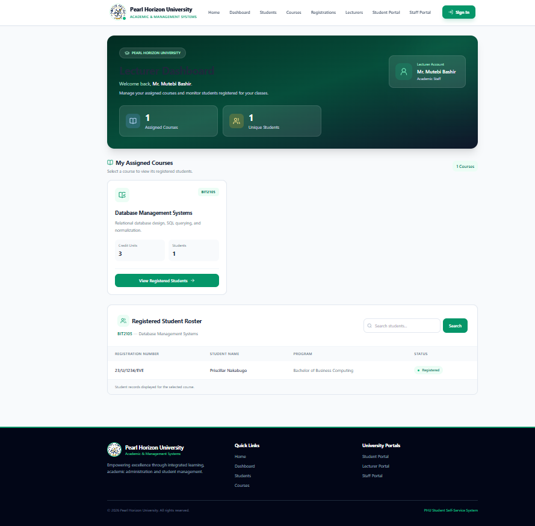
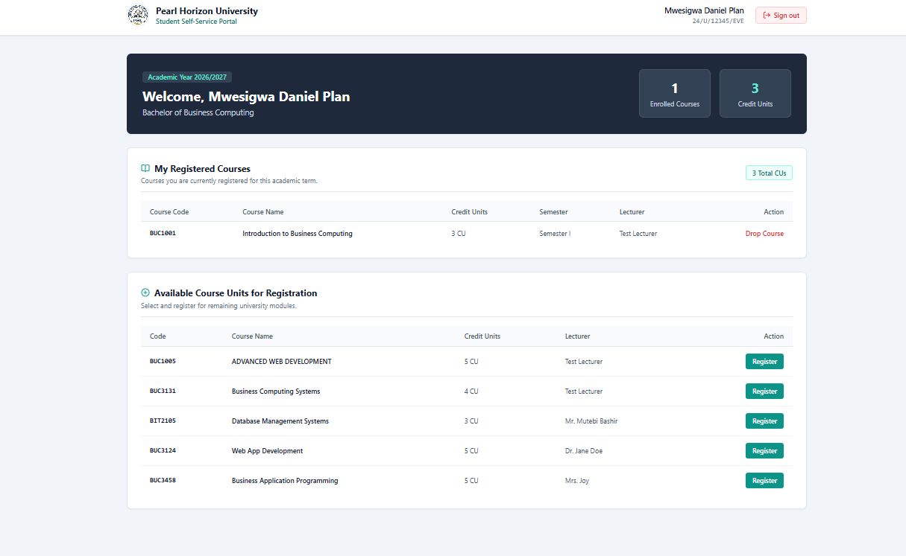
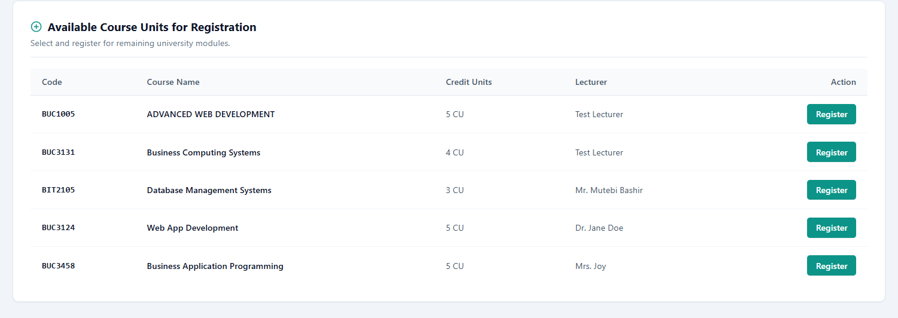

# Pearl Horizon University – Student Management System

## 1. Project Overview

The Pearl Horizon University (PHU) Student Management System is a web-based application developed using Laravel. It helps the university manage student information, courses, lecturer access and student course registrations.

The system provides different dashboards and permissions depending on the user's role.

## 2. Main System Features

- **Administrator:** Manages student records and course information.
- **Lecturer:** Views assigned courses and students registered for those courses.
- **Student:** Views available courses, registers for courses and manages personal course registrations.
- **Authentication:** Provides secure login and role-based access permissions.
- **Course Registration:** Allows students to register for available courses while preventing duplicate registrations.

## 3. Technologies Used

- PHP
- Laravel Framework
- SQLite Database
- HTML and CSS
- JavaScript
- Git and GitHub

## 4. Installation and Setup

### Requirements

- PHP
- Composer
- Node.js and npm
- Visual Studio Code or another code editor
- Git

### Step 1: Clone the Repository

```bash
git clone https://github.com/priscillaricon/PHU-student-management-system.git
```

Navigate into the project folder:

```bash
cd PHU-student-management-system
```

### Step 2: Install Dependencies

```bash
composer install
npm install
```

### Step 3: Configure the Environment

Create your environment file:

```powershell
copy .env.example .env
```

Generate the application key:

```bash
php artisan key:generate
```

### Step 4: Configure the Database

Configure SQLite in the `.env` file:

```env
DB_CONNECTION=sqlite
```

Create the SQLite database file if it does not exist:

```powershell
New-Item database/database.sqlite -ItemType File
```

### Step 5: Run Migrations and Seeders

```bash
php artisan migrate --seed
```

This creates the database tables and inserts the sample records and user accounts.

### Step 6: Build Frontend Assets

```bash
npm run build
```

### Step 7: Start the Application

```bash
php artisan serve
```

Open the application in your browser:

```text
http://127.0.0.1:8000
```

## 5. User Roles and Permissions

| User Role | Main Responsibilities |
|---|---|
| Administrator | Manages students, courses and administrative functions. |
| Lecturer | Views assigned courses and registered students. |
| Student | Views available courses and manages personal course registrations. |

## 6. Sample Login Credentials

The following demonstration accounts are created by the project's database seeders.

| Role | Email | Password |
|---|---|---|
| Administrator | admin@phu.ac.ug | password123 |
| Lecturer | bmutebi@phu.ac.ug | password101 |
| Student | daniel@phu.ac.ug | password789 |

**Note:** These are demonstration credentials for coursework testing only. They should not be used for real accounts or production systems.

## 7. Database Structure

The system uses database relationships to connect students, courses and course registrations.

- A student can register for many courses.
- A course can have many registered students.
- Course registrations connect students and courses.
- Foreign keys maintain relationships between records.
- Duplicate course registrations are prevented.

## 8. GitHub Collaboration

The project was developed collaboratively using Git and GitHub.

**GitHub Repository:**

https://github.com/priscillaricon/PHU-student-management-system

The team used Git branches to organize development and pull requests to integrate contributions into the `develop` branch.

The `main` branch is intended to hold the stable version of the application, while `develop` is used for integrating development work.

## 9. Project Screenshots

The following screenshots demonstrate the main features of the application.

### 9.1 Administrator Dashboard



### 9.2 Student Management



### 9.3 Course Management



### 9.4 Lecturer Dashboard



### 9.5 Student Dashboard



### 9.6 Student Course Registration



## 10. Conclusion

The Pearl Horizon University Student Management System provides a centralized platform for managing student records, courses, lecturer access and student registrations. It uses Laravel authentication, role-based access control and database relationships to support university academic administration.